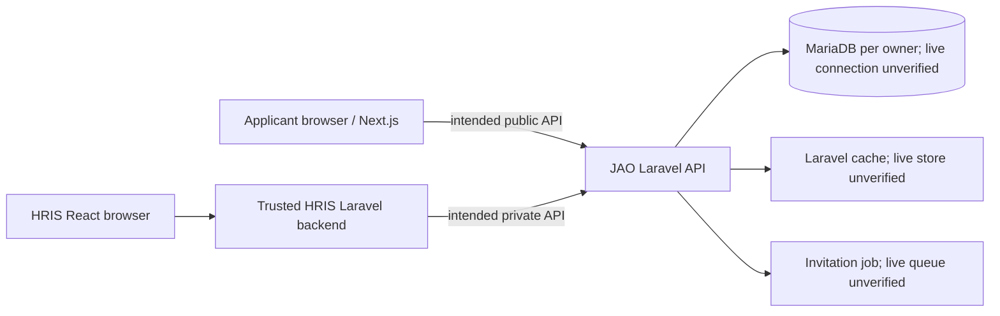

# JAO Architecture and Dynamic Forms

**Documentation date:** 2026-10-28. **Source revision:** `9cb1a64af7f6342b9a5dde13a00d5a9bf608a452` plus pre-existing working-tree changes. This is a static source map, not a deployed topology. [Project context](PROJECT_CONTEXT.md) distinguishes owner intent from repository evidence.

## Components and trust boundaries

The diagram shows **intended** public/private callers. In current source, invitation-form GET is public and token-scoped; administrative routes and application submission remain under `jao.key` and `web` (`routes/api.php`). The JAO operator sets the expected key in JAO's environment; HRIS consumes it by sending it in the request header. The HRIS Laravel backend is the intended sender, but its implementation was not inspected. JAO does not generate or issue the key (`config/services.php:37-42`; `app/Http/Middleware/JaoApiKey.php:13-33`). `VerifyHmacSignature` is implemented but not attached to production routes. A Google Socialite controller exists (`app/Http/Controllers/AuthController.php:13-75`), but no route to it appears in the inspected route files.

Current source is organized under `app/Http/Controllers`, `app/Http/Requests`, `app/Http/Resources`, and `app/Models`. Middleware lives in `app/Http/Middleware/JaoApiKey.php`, `app/Http/Middleware/VerifyHmacSignature.php`, and `app/Http/Middleware/ValidateApplicationInvitation.php`. The reorder actions are `app/Actions/FormField/ReorderFormFields.php` and `app/Actions/FormFieldOption/ReorderFormFieldOption.php`; invitation delivery uses `app/Jobs/SendApplicantInvitation.php` and `app/Notifications/ApplicationInviteNotification.php`. No `app/Services` or `app/Policies` directory was present in this source snapshot; do not infer a service or policy layer from Laravel conventions alone.

## Dynamic-form model map

| Component | Verified relationship or role | Source |
| --- | --- | --- |
| `JobHiring` | Has many invitations and applications; many-to-many form versions through `job_form_version_assignments`. | `app/Models/JobHiring.php:39-56` |
| `FormTemplate` | Has many `FormVersion` records. | `app/Models/FormTemplate.php:20-23` |
| `FormVersion` | Belongs to a template; many-to-many jobs; has many sections and applications. | `app/Models/FormVersion.php:23-40` |
| `FormSection` | Belongs to a version; has many fields. | `app/Models/FormSection.php:22-29` |
| `FormField` | Belongs to a section; has many options. | `app/Models/FormField.php:34-41` |
| `FormFieldOption` | Belongs to a field. | `app/Models/FormFieldOption.php:21-24` |
| `JobFormVersionAssignment` | Pivot table and controller/resource, **not an Eloquent model class** in inspected source. It links jobs to versions. | `database/migrations/2026_08_27_084800_create_job_form_version_assignments_table.php:16-24`; `app/Http/Controllers/JobFormVersionAssignmentController.php:16-53` |
| `ApplicationInvitation` | Belongs to a job. Its `application()` method declares `BelongsTo`, although the application table owns `application_invitation_id`; review this inverse relationship before relying on it. | `app/Models/ApplicationInvitation.php:23-30`; `database/migrations/2026_08_28_024347_create_applications_table.php:20` |
| `Application` | Belongs to invitation, job, and version; has many answers and onboarding records. | `app/Models/Application.php:51-78` |
| `ApplicationAnswer` | Belongs to an application and a form field. | `app/Models/ApplicationAnswer.php:19-26` |

The migration source defines foreign keys along the form and application chains. The pivot migration has no active unique constraint on `(job_hiring_id, form_version_id)` (`database/migrations/2026_08_27_084800_create_job_form_version_assignments_table.php:16-24`). `form_versions.version` is unique globally in migration source, while the controller computes the next number per template (`database/migrations/2026_08_27_084606_create_form_versions_table.php:19`; `app/Http/Controllers/FormVersionController.php:36-51`). Actual schema state was not checked.

Onboarding has a separate source discrepancy: the pivot named `job_onboarding_template_version` links `JobHiring` to `OnboardingTemplate`, not `OnboardingTemplateVersion` (`database/migrations/2026_08_28_055201_create_job_onboarding_template_version.php:16-20`; `app/Models/JobHiring.php:44-47`). Its intended version-assignment rule remains unverified.

## Intended application flow versus source

| Step | Status at this snapshot |
| --- | --- |
| 1. HRIS personnel create job-specific templates and fields. | **Owner intent; JAO CRUD routes implemented.** HRIS identity/permissions and HRIS application were not inspected. |
| 2. Publish a version and assign it to a job. | **Partial.** Version creation sets `published_at` only for status `published` (`app/Http/Controllers/FormVersionController.php:47-54`); assignment accepts existing version IDs without a published-state rule (`app/Http/Requests/CreateJobFormVersionAssignment.php:28-30`). |
| 3. JAO manages invitations and job/form assignment. | **Partial.** Private invitation creation checks for a published job and assigned published form, hashes tokens, and sets expiry. No evidence the invitation pins a specific form version. |
| 4. Applicant opens Next.js. | **Owner intent; external frontend not inspected.** |
| 5. Next.js retrieves an authorized published form. | **Partial.** `app/Http/Controllers/ApplicationFormController.php:19-34` checks the hashed, unexpired, unused token and selects the first published version assigned to the job; the GET route is public and rate limited. Version selection and external Next.js behavior remain unverified. |
| 6. Applicant completes and submits answers. | **Owner intent; external frontend not inspected.** |
| 7. JAO validates invitation, version, fields, and answers. | **Partial.** Request checks UUID existence (`app/Http/Requests/CreateApplicationAnswerRequest.php:29-40`); it does not check version assignment, field ownership, field-specific rules, or duplicate fields. |
| 8. JAO persists atomically. | **Partial.** Submission uses a transaction and invitation row lock, then marks the token used (`app/Http/Controllers/ApplicationSubmissionController.php:35-62`), but the answer array is initialized empty and no submitted answers are mapped. |
| 9. Internal system reviews applications. | **Read endpoints implemented; review workflow unverified.** `routes/api.php:48-49,66` exposes application and answer reads behind the API key. |
| 10. Onboarding follows. | **Planned/incomplete.** Models and migration source exist, but controllers are scaffolds and no onboarding routes appear in `routes/api.php`. |

The queued invitation job takes an invitation model and raw token and implements Laravel's encrypted-job contract (`app/Jobs/SendApplicantInvitation.php`). Runtime queue storage and delivery behavior remain unverified. See [business rules](BUSINESS_RULES.md), [API boundaries](API_BOUNDARIES.md), and [caching roadmap](CACHING_ROADMAP.md) before proposing changes.
